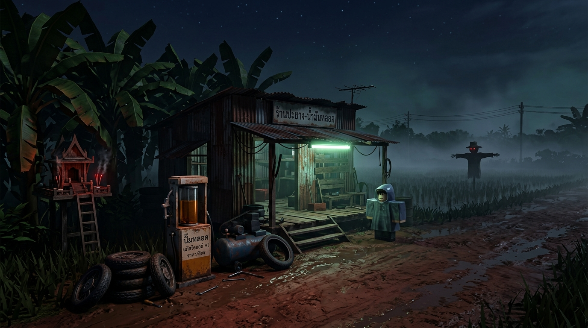

# ⛽ ปั๊มหลอด & เพิงปะยางท้ายทุ่ง (The Rural Tire & Gas Shack)
**Roblox Co-op Horror Anomaly Game (1–6 Players)**

## 📌 ภาพรวมโปรเจกต์ (Project Summary — อัปเดต 2026-11-05)
- **แนวเกม:** Co-op Anomaly Observation / Job Simulator Horror (1–6 คน, แยก 2 Place: **Lobby วัดไทยชนบท** `70980777393906` & **Pump Lot แมพปั๊มหลอด** `114125276809667`)
- **บรรยากาศ:** เพิงสังกะสีปั๊มน้ำมันหลอดแก้วและร้านปะยางริมถนนดินลูกรัง กลางทุ่งนาและดงกล้วยตานี
- **กลไกหลัก (พนมมือสวดมนต์เปิดตาทิพย์):** กดค้าง **G** (PC) / **Y** (จอย) / ปุ่ม **🙏** (มือถือ) พนมมือ 1.5 วินาทีเพื่อเปิด **"ตาทิพย์" (`PrayerSight`)** เห็นสิ่งผิดปกติ (`GhostOnly`) และซ่อนภาพลวงตา (`NormalOnly`) เฉพาะบนจอคนที่สวด · ไฟฉายกบ `FrogFlashlight` ใช้ส่องทางอย่างเดียว
- **เป้าหมายการชนะ (Win Quota):** เก็บเงินครบ **800 บาท** และเล่นอย่างน้อย 15 นาที · เงินมาจากลูกค้าเท่านั้น (เบนซิน 100฿ / ดีเซล 300฿ / เติมลม 20฿ / ผีไม่จ่าย) · ค่าเฝ้าร้านตอนจบคืนแยกต่างหาก คูณตามความยาก Easy ×1, Normal ×1.5, Hard ×2, Nightmare ×3
- **พลังชีวิตทีม:** ธูปที่ศาลพระภูมิ **3 ดอก** (ไม่โชว์บน HUD ต้องเดินไปดูเอง — เติมให้ผี = ธูปดับ 1 ดอก + หัก 100฿, ดับครบ 3 = Game Over)
- **การรองรับภาษา:** 2 ภาษา ไทย / อังกฤษ (`TH` / `EN`)

---

## 🎮 ทุกอย่างที่มีในเกมตอนนี้ (Current Game Content — 2026-11-05)
สรุปสำหรับคนที่เพิ่งมาดูโปรเจกต์ รายละเอียดเชิงเทคนิคดูใน [GEMINI.md](GEMINI.md)

### 🏯 Lobby (วัดไทยชนบทตอนกลางคืน — Place แยก)
- วัดครบชุด: ซุ้มประตู โบสถ์ เมรุ กุฏิ ศาลา เจดีย์บรรจุกระดูก งานสวดอภิธรรมในศาลา ต้นไทรพันผ้าสามสี ดงกล้วย ป่ารอบวัด หมอก ไฟกะพริบ เงาผู้หญิงชุดขาวใต้ต้นไทร (จางหายเมื่อเข้าใกล้)
- **สร้างห้อง:** เดินเข้าวง `RoomPad` 4 วง = เป็นเจ้าของห้อง เลือกผู้เล่น 1–6 คน + ความยาก 4 ระดับ คนอื่นเดินเข้าวงเพื่อเข้าห้อง เจ้าของกด "เริ่มเกม" = วาร์ปทั้งห้องไปแมพปั๊มหลอด
- ทำบุญ/บริจาค (`TempleMerit`), กระดานผู้บริจาค, ตู้บริจาค, รถเข็นขายของ, Leaderboard
- สมุดสะสมผีและหน้าตั้งค่าใช้ร่วมกับในเกม (DataStore เดียวกัน)

### 🎬 คัทซีน
- **เปิดคืน:** พี่ชายขี่รถพาผู้เล่นมาตอนเย็น (รถเปลี่ยนตามจำนวนคน: มอไซค์ / ตุ๊กตุ๊ก / เก๋ง / กระบะ) → คุยกัน → เดินไปดึงเชือกยกแผงร้าน → ขี่ออก → ผู้เล่นเดินเข้าร้าน → ตะวันตกดิน → กลางคืน ไฟดับ
- **จบคืน (ชนะ):** เช้ามืด พี่ชายขี่มารับ → หน้าสรุปผล (ทีม + รายคน: เติมกี่ครั้ง ทำเงิน ไล่ผี ถวาย ค่าเฝ้าร้าน) → ทุกคนกด "เฝ้าต่ออีกคืน" เพื่อเริ่มคืนใหม่
- **เสียงพากย์อีสานคนจริง:** บทพี่ชายและผู้เล่น (ชาย) ในคัทซีนเปิด · ลูกค้าทักทาย/คุย/สั่งน้ำมัน/จ่ายเงิน/เร่ง/เติมผิดตู้/พูดตอนเปิดปิดแผง/ทักคนพนมมือ · รถเครื่องเสียงและรถแห่ · พูดทีละประโยคไม่ทับกัน · **ผู้เล่นพูดเฉพาะในคัทซีน** (ระหว่างเล่นเหลือแค่เสียงสวดตอนพนมมือ) · เด็กแว้นไม่พูดและไม่มีซับ · รายการบทที่ต้องพากย์: [assets/sounds/VoiceScript.xlsx](assets/sounds/VoiceScript.xlsx)
- ข้ามได้ (Enter / ปุ่ม B / แตะค้าง) · ระหว่างคัทซีนปุ่มในฉากไม่ขึ้นและเสียงสุ่มรอบทุ่งเงียบ · กล้องเลือกมุมที่ไม่โดนตู้ปั๊ม/เสา/รถบังเอง (`clearCamPos`)

### 🌙 หนึ่งคืนในร้าน (Core Loop)
1. **ไฟดับตอนเริ่ม:** เปิดไฟฉาย [1] → ดึงเชือกเปิดแผงร้าน → ไปสตาร์ท **เครื่องปั่นไฟ** หลังดงกล้วย (มินิเกมวงจังหวะ Space/แตะ ช่วยกันหลายคนได้ พลาด = โดนไฟช็อตกระเด็น)
2. **น้ำมันเริ่มต้นว่าง:** หยิบแกลลอน [3] มุมหลังร้าน → ตักที่ถังหลังร้าน → เทใส่ตู้หน้าร้าน · **ตักจากถังไหนก็ได้ (แดงหรือน้ำเงิน) แล้วเทได้ทั้งตู้ซ้ายและขวา** แต่เทครั้งละ 1 ตู้ (ตู้ซ้ายกับขวาเติมแยกกัน) · เติมให้ลูกค้า 1 ครั้งใช้ 1/4 หลอด หมดก็ต้องไปตักใหม่
3. **แผงน้ำมันขวดหน้าร้าน = ของประกอบฉาก** (ไม่ได้ขาย ไม่มีปุ่มเติม) ว่างตอนเริ่มคืนเหมือนตู้ เทตู้แดงเต็ม = ขวดแดงเต็ม, เทตู้เขียวเต็ม = ขวดเขียวเต็ม
4. **ถวายขนมที่ศาลพระภูมิ:** หยิบขนม [2] ที่ถาดบนเคาน์เตอร์ → ถวาย = คุ้มครอง 150 วิ (แถบเวลามุมขวาบน) มือผีเหี่ยวๆ ยื่นออกมาจากศาลคว้าขนมเข้าไป · ไม่คุ้มครอง = ผีมาบ่อยขึ้น + อาการหลอน (จอเขย่า / เดินช้า / สะดุดล้ม)
5. **ลูกค้ามาทีละคน (ราว 85 วิต่อราย):** รถไทยหลายแบบ + คนเดินเท้าถือแกลลอน/กางร่ม (ชาวบ้านแบบใหม่ สุ่มชุด/ทรงผม/เสียง) ทักทาย สั่ง แล้วตอบราคา → เล่นมินิเกม **เติมน้ำมัน** (กดค้างให้หยุดในขีดทอง) / **เติมลมจักรยาน** (กดตรงจังหวะ 3 ครั้ง) — มือถือขึ้นคำว่า "แตะ / Tap"
6. **ดูผีก่อนเติม:** พนมมือเปิดตาทิพย์ ถ้าเป็นผี ห้ามเติม → ดึงเชือกปิดแผงร้าน (ไม่ได้เงิน แต่นับเป็นผลงานในค่าเฝ้าร้าน) · **ใครอยู่นอกร้านตอนปิดใส่ผี: โดนหลอก ล้ม ตาปรือ ลุกไม่ได้จนผีปั่นป่วนเสร็จ** (เคาะแผง / วิ่งรอบร้าน / ขึ้นหลังคา 14–22 วิ) · เติมให้ผี = เสียงจั๊มสแกร์ `Jumpscare_1/2` · ลูกค้าผีพูดเหมือนคนปกติ ไม่มีป้ายบอกว่าเติมให้ผี
7. เก็บครบ 800฿ (และเล่นครบ 15 นาที) = ชนะ (คัทซีนเช้า) · ธูปดับครบ 3 = จอตาย (เริ่มใหม่ / กลับ Lobby)

### 👻 ผี
- **ผีที่มากับลูกค้า (9 แบบ):** คนซ้อนไร้หัว (`Headless`), ป้ายทะเบียนป่าช้า 4444 (`Cemetery`), ผมพันล้อ (`WheelHair`), คอหมุน (`NeckTwist`), ยิ้มแสยะ (`CreepySmile`), กระสือ (`Krasue`), วิทยุสวดศพ (`MonkRadio`), น้ำมันเลือด (`BloodFuel`), เดินตากฝนไม่กางร่ม (`NoUmbrella`) — ไม่มีเสียงเตือนตอนเจอ ต้องสังเกตเอง เผลอเติม = Jumpscare
- **ผีฉาก (ไม่เกี่ยวกับลูกค้า โผล่นานๆ ครั้ง แต่ละคนเห็นคนละตัว):**
  - **อยู่ที่ของมัน แล้วเดินมาเมื่อถูกเห็น (ตานี นางรำ แม่นาค กุมารทอง ผีเด็ก ศพห่อผ้า กระสือ ปอบ):** โผล่ที่ดงกล้วย/ต้นไทร/ทุ่ง ไม่มีใครเห็น 30–45 วิ = จางหาย · หันไปเห็น = เดินเข้าหาคนนั้น (เดินหนีได้ แต่ไล่นานสุด 14 วิ)
  - **ไล่ถึงตัว / หนีไม่พ้น / ปิดแผงระหว่างถูกไล่:** ทุกคนที่อยู่นอกร้าน (และคนที่ถูกไล่ถึงตัวในร้านตอนแผงเปิด) โดนหลอก ล้ม ตาปรือ จนผีปั่นป่วนเสร็จ · ปิดแผงแล้วไม่มีใครอยู่นอกร้าน = ผีจางหายไป
  - **เปรต กระหัง (เดินผ่านไกลๆ) และเงาหลังต้นไทร:** จ้องค้าง 2.5 วิ = พุ่งใส่หน้าเฉพาะคนที่จ้อง · **หุ่นไล่กา:** ถูกมองแล้วถอยหนีไปในทุ่ง
  - **มีเสียงตกใจเฉพาะตอนพนมมือจนตาทิพย์เปิดแล้วหันไปเจอ** (ไม่สวดแล้วหันไปเจอ = เงียบ)
- **เสียงสวดตอนพนมมือ:** สวดแบบปกติเสมอ (ไม่มีโหมดสวดเร็วตอนเจอผีแล้ว) ดังขึ้น และ **เพื่อนได้ยินเสียงสวดของเราด้วย** (เสียง 3D ที่หัวคนสวด) · เสียงสวด/วิทยุอยู่ในแถบเสียง "เพลง" ของหน้าตั้งค่า ถ้าปรับเป็น 0 จะไม่ได้ยิน
- **สวดตอนร้านว่างนานๆ** มีโอกาสเรียกผีมาเอง + ลูกค้าคนถัดไปมีโอกาสเป็นผี · ลูกค้าทักคนที่ยืนพนมมือ
- คลังไอเดียผีไทย 92 ตัวสำหรับทำเพิ่ม: [art_refs/ghosts/GHOSTS.md](art_refs/ghosts/GHOSTS.md)

### 🌧️ เหตุการณ์และบรรยากาศ
- ฝนตกเป็นช่วงๆ (ไม่ทะลุหลังคาเพิง พื้นเปียก ฟ้าแลบ คนแวะหลบฝน ลูกค้ากางร่ม)
- ขาจรบนถนน: เด็กแว้น / รถซิ่งเปิดเพลง / ขบวนรถแห่งานบวช
- วิทยุทรานซิสเตอร์บนโต๊ะ (เล่นเพลง `radio_song` เพลงเดียว ไม่มีเสียงผีร้องโอเปร่าแทรกแล้ว เสียงสวดแว่วแทรกแค่แป๊บเดียวตอนมีผีวิทยุหรือสวดเรียกผี) · เสียงจิ้งหรีดที่เงียบกริบเป็นพักๆ · เสียงธรรมชาติรอบทุ่งสุ่มทุก 1 นาที · ลมพัดหญ้า/ข้าว/ใบไม้ · ไฟเสาไม้กะพริบ · หมอกเรี่ยพื้น

### 🧑‍🌾 ตัวละคร
- ผู้เล่นและลูกค้าเป็น **ชาวบ้านแบบใหม่** (skinned mesh จาก Blender) สุ่มชุด/ทรงผม · ผู้เล่นใส่ม่อฮ่อม
- หัว/ลำตัว/แขนไฟฉายของเพื่อนหันตามมุมกล้องจริง · ถือแกลลอน/ขนมในมือจริง · **เลือกมือถือไฟฉายซ้าย/ขวาได้ในหน้าตั้งค่า** (ของอื่นไปอยู่อีกมือ)

### 🧰 ระบบช่วยเล่น / UI
- **สอนเล่นทีละขั้น** ครั้งแรกที่เข้าเกม (8 ขั้น มีกรอบเรืองแสงที่ของที่ต้องกด, [H] ซ่อน)
- HUD ยอดเงิน, ช่องไอเทม [1] ไฟฉาย [2] ขนม [3] แกลลอน, ซับไตเติลคำพูดอยู่เหนือช่องไอเทม (ไม่ทับกัน)
- ปุ่มกดในฉากขึ้นเฉพาะของที่ใกล้สุดและมองเห็นจริง (ไม่กดทะลุผนัง)
- สมุดสะสมผี, หน้าตั้งค่า, จอตาย, หน้าสรุปผล, แผง admin (F2) สำหรับทดสอบ (มีปุ่มจัดร้านพร้อมขายทันที)

### ⌨️ ปุ่มควบคุม
| การกระทำ | PC | มือถือ |
|---|---|---|
| ทุกปุ่มโต้ตอบในฉาก (หยิบ ตัก เท เติม ดึงเชือก วิทยุ ถวาย ขึ้นรถ ไฟหน้ารถ) | **E** (กดหรือกดค้างตามปุ่ม) | แตะปุ่มบนจอ |
| มินิเกมเติมน้ำมัน / เติมลม / เครื่องปั่นไฟ | **Space** หรือคลิกซ้าย · ออก X | **แตะ (Tap)** |
| พนมมือเปิดตาทิพย์ | กดค้าง **G** (จอย **Y**) | ปุ่ม 🙏 |
| สลับไอเทม | 1 / 2 / 3 | แตะช่องไอเทม |
| ปลดล็อกเมาส์ | V / LeftAlt | — |
| ซ่อนคำแนะนำสอนเล่น | H | — |
| ข้ามคัทซีน | Enter (จอย B) | แตะค้าง |
- ถือแกลลอนอยู่ที่ตู้ที่ต้องเติม = ขึ้นแต่ปุ่มเทน้ำมัน (เก็บแกลลอนก่อนถ้าจะกดเติมให้ลูกค้า)

---

## 📂 ไฟล์สำคัญในโปรเจกต์นี้
1. **[GEMINI.md](GEMINI.md)** — คู่มือส่งมอบงานสำหรับ AI (AI Context & Handoff Guide) อธิบายโครงสร้างโค้ด โฟลเดอร์ใน `Workspace`/`ServerStorage` ระบบ Rojo 2 Place และกฎการแก้ไขฉากแบบไม่ทำลายตำแหน่งที่จัดวางไว้
2. **[GDD.md](GDD.md)** & **[art_refs/ghosts/GHOSTS.md](art_refs/ghosts/GHOSTS.md)** — เอกสาร Game Design Document ฉบับเต็ม และคลังข้อมูลอ้างอิงผีไทย 92 ตัว (Rig, Status, Animation)
3. **[src/shared/MapBuilder.luau](src/shared/MapBuilder.luau)** — โมดูลสร้างฉากปั๊มหลอดและวัด Lobby (`BuildTempleLobby`) พร้อมฟังก์ชันอัปเดตเฉพาะจุด (`PaintTerrainRoad`, `AddSacredBanyanZone`, `AddSideRiceFields`, `SplitSideRiceFields`, `BuildCompactPerimeter`, `SpreadBananaGrove`, `TagWindPlants`, `BuildThaiVehicleTemplates`, `OptimizeShadowsAndCleanup`, `RemoveZoneLabels`, `DarkenRiceAndFoliage`)
4. **[src/server/GameManager.server.luau](src/server/GameManager.server.luau)** — สคริปต์ควบคุมเกมฝั่ง Server (สลับแสงกลางคืนไร้ดาวเมื่อกด Play, ล็อก First-Person + ปิดกระโดด, ไฟนีออนเสาไม้กะพริบทุก 25–55 วิ, เชือกดึงแผงสังกะสี `ShutterDoor`, กระจายดงกล้วย, ปิดเงาใบไม้/ทุ่งนา, ลบป้ายลอย `ZoneLabel`, กดสีต้นข้าวให้กลืนกับความมืด)
5. **[src/server/Prayer.luau](src/server/Prayer.luau)** & **[src/client/PrayerController.client.luau](src/client/PrayerController.client.luau)** — ระบบพนมมือสวดมนต์ (กด G ค้าง ยืนนิ่งพนมมือ R15 + เสียงสวดตัวเองที่เปลี่ยนเป็นสวดรัวเร็วเมื่อเจอผี + เปิดม่านตาทิพย์เห็น `GhostOnly` / ซ่อน `NormalOnly`)
6. **[src/server/CoreLoop.luau](src/server/CoreLoop.luau)** — ลูปหลัก: คิวรถทีละคัน (`MaxQueue = 1`), บทสนทนาไหลอัตโนมัติ, มินิเกมเติมน้ำมัน 2 ตู้ (เบนซิน/ดีเซล) + เติมลมจักรยาน (`ServiceMinigame`), ดึงแผงปิดร้าน, เป้าหมายเงิน `1,500฿`, ธูป 3 ดอก, ลูกค้าทักคนพนมมือ (`watchPrayers`), สวดตอนร้านว่างสุ่มเรียกผี (`prayerSummonLoop`), จบเกมกลับ Lobby (`TeleportAsync`) · ทดสอบด้วย `ServerStorage.DevDecision:Fire("fuel" | "reject")`
7. **[src/server/AnomalyManager.luau](src/server/AnomalyManager.luau)** — ผีลูกค้า 9 ตัว (Headless, Cemetery 4444, WheelHair, NeckTwist, CreepySmile, Krasue, MonkRadio, BloodFuel, NoUmbrella) + ผีฉาก 3 ตัว (Tani, Scarecrow, Shadow — `ShowScenery`) ใช้ระบบม่านตาทิพย์ `ghostOnly()` / `normalOnly()` / `unveil()` / `apparition()` + วิทยุทรานซิสเตอร์ (`E` เปิด/ปิด) + ระบบสุ่มเสียงธรรมชาติรอบทุ่งทุกๆ 1 นาที (`DogHowl`, `WindLeaves1..2`, `WindGust`, `NightFrogs`, `TreeBranchCreak`, `ShackTinWoodCreak`, `NightBirdWings`) · บังคับผีตัวถัดไปด้วย `ServerStorage.DevDecision:SetAttribute("ForceAnomaly", "Anomaly_Krasue")`
8. **[src/server/Flashlight.server.luau](src/server/Flashlight.server.luau)** — ไฟฉายกบ (`StarterPack.FrogFlashlight`) เปิดไฟอัตโนมัติเมื่อถือ ทำงานคู่กับโมเดลไฟฉาย 3D ล็อกตามกล้องฝั่ง Client
9. **[src/shared/LanguageModule.luau](src/shared/LanguageModule.luau)** & **[src/shared/SoundBank.luau](src/shared/SoundBank.luau)** — ระบบข้อความ 2 ภาษา (`TH`/`EN`) และคลังเสียงพูดลูกค้า/เสียงสวดมนต์อีสาน-ไทย/เสียงเหตุการณ์ริมถนน
10. **[src/client/HUDController.client.luau](src/client/HUDController.client.luau)** & **[src/client/ObjectLabels.client.luau](src/client/ObjectLabels.client.luau)** — HUD ยอดเงิน `฿0 / ฿1500`, ซับไตเติลคำพูดลูกค้าด้านล่าง, มินิเกมเติมน้ำมัน/เติมลม (`FuelView` / `AirView`), ช่องถือไฟฉาย `[1] ไฟฉาย`, โมเดลไฟฉาย 3D ล็อกตามกล้อง (`CameraFlashlightViewmodel`), ระบบสลับเมาส์ `V` / `LeftAlt`, และตัดป้ายชื่อลอย `ZoneLabel` เหนืออุปกรณ์ออกทั้งหมด
11. **[src/client/AmbienceController.client.luau](src/client/AmbienceController.client.luau)** & **[src/client/GrassWind.client.luau](src/client/GrassWind.client.luau)** — บรรยากาศกลางคืนตามสูตร Atmosphere Blueprint (ท้องฟ้าไร้ดาว `StarCount = 0` เหลือเฉพาะดวงจันทร์ + หมอกยามวิกาล + โทนสีหนังผีไทยยุค 90s + เสียงจิ้งหรีดเหงาๆ + เสียงฝีเท้าธรรมชาติเบาๆ แยกตามพื้นผิว) และระบบลมพัดหญ้า/ต้นข้าว/ใบไม้ไหวที่ปรับระยะตามหมอกกลางคืน (`ACTIVE_RANGE = 85`, `LEAF_RANGE = 60`) พร้อม Batch Registration ตอนเริ่มเกม
12. **[src/server/Weather.luau](src/server/Weather.luau)** + **[src/client/WeatherController.client.luau](src/client/WeatherController.client.luau)** — ระบบฝนตกเป็นช่วงๆ แบ่งโซนปล่อยเม็ดฝน 4 ด้านรอบนอกเพิงกันฝนทะลุหลังคา พื้นเปียก ฟ้าแลบ คนแวะหลบฝน
13. **[src/server/Pedestrian.luau](src/server/Pedestrian.luau)** & **[src/shared/ThaiVehicleRigs.luau](src/shared/ThaiVehicleRigs.luau)** + **[src/server/ThaiVehicleDrive.server.luau](src/server/ThaiVehicleDrive.server.luau)** — ลูกค้าเดินเท้าถือแกลลอน/ร่ม, รถไทย 8 คัน (กระบะเก่า, เก๋ง, จักรยาน 2 แบบ, ตุ๊กตุ๊ก, เวฟซิ่ง, รถแห่กระบะ, รถแห่ 6 ล้อ) และขาจรช่วงพัก
14. **[src/client/JumpscareController.client.luau](src/client/JumpscareController.client.luau)** & **[src/client/DeathScreen.client.luau](src/client/DeathScreen.client.luau)** — ผีโผล่เต็มจอตอนเผลอเติมให้ผี และหน้าจอตาย/กลับ Lobby
15. **[src/server/AnomalyBook.luau](src/server/AnomalyBook.luau)** + **[src/client/BookController.client.luau](src/client/BookController.client.luau)** & **[src/server/PlayerSettings.server.luau](src/server/PlayerSettings.server.luau)** + **[src/client/SettingsController.client.luau](src/client/SettingsController.client.luau)** — สมุดสะสมผีไทยและหน้าตั้งค่าผู้เล่น (บันทึกใน DataStore ร่วมกันทั้ง Lobby และเกม)
16. **[src/lobby/](src/lobby/)** (`LobbyServer.server.luau`, `TempleMerit.server.luau`, `LobbyClient.client.luau`) — ระบบวัด Lobby สร้างห้อง 1–6 คน เลือกความยาก ทำบุญ/บริจาค และวาร์ปเข้าแมพปั๊มหลอด

---

## 💻 วิธีสลับทำงานหรือให้ AI ตัวอื่นทำต่อ (Prompt สำหรับเริ่ม Session ใหม่)
เมื่อเปิดแชท Session ใหม่ ให้ก๊อปปี้ข้อความด้านล่างนี้ส่งให้ AI ได้เลย:
> **"ช่วยอ่านไฟล์ `@[GEMINI.md]`, `@[GDD.md]` และ `@[README.md]` ในโฟลเดอร์นี้ เรากำลังพัฒนาเกม Roblox ปั๊มหลอดท้ายทุ่ง (แยก 2 Place: วัด Lobby พอร์ต 34873 และแมพปั๊มหลอด พอร์ต 34872) ตอนนี้ระบบหลักทั้ง 5 เฟส (ฉากปั๊ม+วัด, รถไทย 8 คัน+คนเดินเท้า, Core Loop เป้า 1500฿, ระบบพนมมือสวดมนต์เปิดตาทิพย์ดูผีลูกค้า 9 ตัว + ผีฉาก 3 ตัว, ฝนตก/ขาจร, สมุดสะสมผี, ตั้งค่า, คัทซีนเปิด/จบคืน, เครื่องปั่นไฟ, แกลลอน+ถังน้ำมัน 1:1 กับตู้, ศาลพระภูมิ+ถวายขนม, สอนเล่น) เสร็จแล้ว ดูสรุปทั้งหมดในหัวข้อ "ทุกอย่างที่มีในเกมตอนนี้" ของ README กำลังจะทำต่อในส่วน..."**
