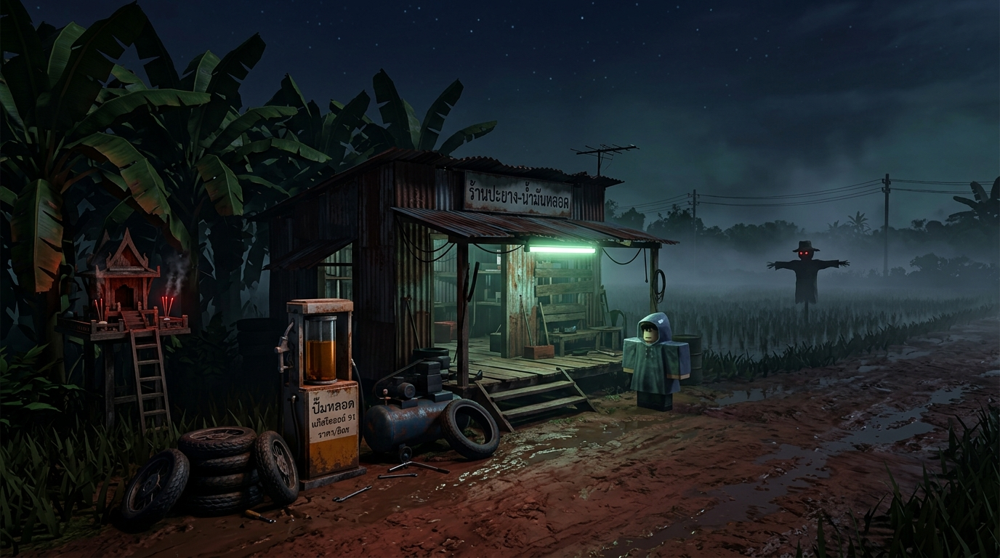

# ⛽ ปั๊มหลอด & เพิงปะยางท้ายทุ่ง (The Rural Tire & Gas Shack)
**Roblox Co-op Horror Anomaly Game (1–6 Players)**

## 📌 ภาพรวมโปรเจกต์ (Project Summary — อัปเดต 2026-10-29)
- **แนวเกม:** Co-op Anomaly Observation / Job Simulator Horror (1–6 คน, แยก 2 Place: **Lobby วัดไทยชนบท** `70980777393906` & **Pump Lot แมพปั๊มหลอด** `114125276809667`)
- **บรรยากาศ:** เพิงสังกะสีปั๊มน้ำมันหลอดแก้วและร้านปะยางริมถนนดินลูกรัง กลางทุ่งนาและดงกล้วยตานี
- **กลไกหลัก (พนมมือสวดมนต์เปิดตาทิพย์):** แทนที่จะส่องไฟฉายดูผี ผู้เล่นต้องกดค้าง **G** (PC) / **Y** (จอย) / ปุ่ม **🙏** (มือถือ) ยืนพนมมือสวดมนต์ 1.5 วินาทีเพื่อเปิด **"ตาทิพย์" (`PrayerSight`)** มองเห็นสิ่งผิดปกติ (`GhostOnly`) และซ่อนภาพลวงตา (`NormalOnly`) เฉพาะบนจอของคนที่กำลังสวดมนต์เท่านั้น! (ส่วนไฟฉายกบ `FrogFlashlight` ใช้ส่องสว่างในความมืดตามปกติ โดยเปิดไฟอัตโนมัติและล็อกโมเดลไฟฉาย 3D ตามมุมกล้อง First-Person)
- **มุมมองและการควบคุม:** บังคับมุมมองบุคคลที่ 1 (`LockFirstPerson`), ปิดการกระโดด (`WalkSpeed = 10`), กด `V` / `LeftAlt` เพื่อสลับล็อกเมาส์, กด `R` เปิด/ปิดวิทยุทรานซิสเตอร์บนโต๊ะ, และใช้มินิเกมกดจังหวะ (`Space` / คลิกซ้าย) สำหรับปั๊มน้ำมันหลอดแก้วและเติมลมยาง
- **เป้าหมายการชนะ (Win Quota):** ให้บริการรถและชาวบ้านจนเก็บเงินในกระป๋องครบ **1,500 บาท** (คนปกติ +100฿ / ปิดร้านหนีผีได้โบนัส +50฿ / คูณรางวัลตามความยาก Easy ×1, Normal ×1.5, Hard ×2, Nightmare ×3)
- **พลังชีวิตทีม:** ธูปที่ศาลพระภูมิ **3 ดอก** (ไม่มีแสดงบน HUD ผู้เล่นต้องเดินไปเช็กธูปที่ศาลพระภูมิเอง — เผลอเติมน้ำมันให้ผี ธูปดับทีละ 1 ดอก พร้อมหัก -100฿ ครบ 3 ดอก = Game Over)
- **การรองรับภาษา:** 2 ภาษา ไทย / อังกฤษ (`TH` / `EN` Localization)

---

## 📂 ไฟล์สำคัญในโปรเจกต์นี้
1. **[GEMINI.md](GEMINI.md)** — คู่มือส่งมอบงานสำหรับ AI (AI Context & Handoff Guide) อธิบายโครงสร้างโค้ด โฟลเดอร์ใน `Workspace`/`ServerStorage` ระบบ Rojo 2 Place และกฎการแก้ไขฉากแบบไม่ทำลายตำแหน่งที่จัดวางไว้
2. **[GDD.md](GDD.md)** & **[art_refs/ghosts/GHOSTS.md](art_refs/ghosts/GHOSTS.md)** — เอกสาร Game Design Document ฉบับเต็ม และคลังข้อมูลอ้างอิงผีไทย 92 ตัว (Rig, Status, Animation)
3. **[src/shared/MapBuilder.luau](src/shared/MapBuilder.luau)** — โมดูลสร้างฉากปั๊มหลอดและวัด Lobby (`BuildTempleLobby`) พร้อมฟังก์ชันอัปเดตเฉพาะจุด (`PaintTerrainRoad`, `AddSacredBanyanZone`, `AddSideRiceFields`, `SplitSideRiceFields`, `BuildCompactPerimeter`, `SpreadBananaGrove`, `TagWindPlants`, `BuildThaiVehicleTemplates`)
4. **[src/server/GameManager.server.luau](src/server/GameManager.server.luau)** — สคริปต์ควบคุมเกมฝั่ง Server (สลับแสงกลางคืนเมื่อกด Play, ล็อก First-Person + ปิดกระโดด, ไฟนีออนเสาไม้กะพริบ, เชือกดึงแผงสังกะสี `ShutterDoor`, กระจายดงกล้วย)
5. **[src/server/Prayer.luau](src/server/Prayer.luau)** & **[src/client/PrayerController.client.luau](src/client/PrayerController.client.luau)** — ระบบพนมมือสวดมนต์ (กด G ค้าง ยืนนิ่งพนมมือ R15 + เสียงสวดตัวเองที่เปลี่ยนเป็นสวดรัวเร็วเมื่อเจอผี + เปิดม่านตาทิพย์เห็น `GhostOnly` / ซ่อน `NormalOnly`)
6. **[src/server/CoreLoop.luau](src/server/CoreLoop.luau)** — ลูปหลัก: คิวรถทีละคัน (`MaxQueue = 1`), บทสนทนาไหลอัตโนมัติ, มินิเกมเติมน้ำมัน 2 ตู้ (เบนซิน/ดีเซล) + เติมลมจักรยาน (`ServiceMinigame`), ดึงแผงปิดร้าน, เป้าหมายเงิน `1,500฿`, ธูป 3 ดอก, ลูกค้าทักคนพนมมือ (`watchPrayers`), สวดตอนร้านว่างสุ่มเรียกผี (`prayerSummonLoop`), จบเกมกลับ Lobby (`TeleportAsync`) · ทดสอบด้วย `ServerStorage.DevDecision:Fire("fuel" | "reject")`
7. **[src/server/AnomalyManager.luau](src/server/AnomalyManager.luau)** — ผีชุดแรก 10 ตัว (Headless, Cemetery 4444, WheelHair, NeckTwist, CreepySmile, Krasue, MonkRadio, Tani, Scarecrow, BloodFuel) ใช้ระบบม่านตาทิพย์ `ghostOnly()` / `normalOnly()` / `unveil()` / `apparition()` + วิทยุทรานซิสเตอร์ (`R` เปิด/ปิด พร้อมเอฟเฟกต์ลำโพงแตก `EqualizerSoundEffect` + `DistortionSoundEffect`) · บังคับผีตัวถัดไปด้วย `ServerStorage.DevDecision:SetAttribute("ForceAnomaly", "Anomaly_Krasue")`
8. **[src/server/Flashlight.server.luau](src/server/Flashlight.server.luau)** — ไฟฉายกบ (`StarterPack.FrogFlashlight`) เปิดไฟอัตโนมัติเมื่อถือ ทำงานคู่กับโมเดลไฟฉาย 3D ล็อกตามกล้องฝั่ง Client
9. **[src/shared/LanguageModule.luau](src/shared/LanguageModule.luau)** & **[src/shared/SoundBank.luau](src/shared/SoundBank.luau)** — ระบบข้อความ 2 ภาษา (`TH`/`EN`) และคลังเสียงพูดลูกค้า/เสียงสวดมนต์อีสาน-ไทย/เสียงเหตุการณ์ริมถนน
10. **[src/client/HUDController.client.luau](src/client/HUDController.client.luau)** & **[src/client/ObjectLabels.client.luau](src/client/ObjectLabels.client.luau)** — HUD ยอดเงิน `฿0 / ฿1500`, ซับไตเติลคำพูดลูกค้าด้านล่าง, มินิเกมเติมน้ำมัน/เติมลม (`FuelView` / `AirView`), ช่องถือไฟฉาย `[1] ไฟฉาย`, โมเดลไฟฉาย 3D ล็อกตามกล้อง (`CameraFlashlightViewmodel`), และระบบสลับเมาส์ `V` / `LeftAlt`
11. **[src/client/AmbienceController.client.luau](src/client/AmbienceController.client.luau)** & **[src/client/GrassWind.client.luau](src/client/GrassWind.client.luau)** — บรรยากาศกลางคืนตามสูตร Atmosphere Blueprint (หมอกยามวิกาล + โทนสีหนังผีไทยยุค 90s + เสียงจิ้งหรีดเหงาๆ + เสียงฝีเท้าหลอนแยกตามพื้นผิวไม้/ดินโคลน/หญ้า) และระบบลมพัดหญ้า/ต้นข้าว/ใบไม้ไหว
12. **[src/server/Weather.luau](src/server/Weather.luau)** + **[src/client/WeatherController.client.luau](src/client/WeatherController.client.luau)** — ระบบฝนตกเป็นช่วงๆ แบ่งโซนปล่อยเม็ดฝน 4 ด้านรอบนอกเพิงกันฝนทะลุหลังคา พื้นเปียก ฟ้าแลบ คนแวะหลบฝน
13. **[src/server/Pedestrian.luau](src/server/Pedestrian.luau)** & **[src/shared/ThaiVehicleRigs.luau](src/shared/ThaiVehicleRigs.luau)** + **[src/server/ThaiVehicleDrive.server.luau](src/server/ThaiVehicleDrive.server.luau)** — ลูกค้าเดินเท้าถือแกลลอน/ร่ม, รถไทย 8 คัน (กระบะเก่า, เก๋ง, จักรยาน 2 แบบ, ตุ๊กตุ๊ก, เวฟซิ่ง, รถแห่กระบะ, รถแห่ 6 ล้อ) และขาจรช่วงพัก
14. **[src/client/JumpscareController.client.luau](src/client/JumpscareController.client.luau)** & **[src/client/DeathScreen.client.luau](src/client/DeathScreen.client.luau)** — ผีโผล่เต็มจอตอนเผลอเติมให้ผี และหน้าจอตาย/กลับ Lobby
15. **[src/server/AnomalyBook.luau](src/server/AnomalyBook.luau)** + **[src/client/BookController.client.luau](src/client/BookController.client.luau)** & **[src/server/PlayerSettings.server.luau](src/server/PlayerSettings.server.luau)** + **[src/client/SettingsController.client.luau](src/client/SettingsController.client.luau)** — สมุดสะสมผีไทยและหน้าตั้งค่าผู้เล่น (บันทึกใน DataStore ร่วมกันทั้ง Lobby และเกม)
16. **[src/lobby/](src/lobby/)** (`LobbyServer.server.luau`, `TempleMerit.server.luau`, `LobbyClient.client.luau`) — ระบบวัด Lobby สร้างห้อง 1–6 คน เลือกความยาก ทำบุญ/บริจาค และวาร์ปเข้าแมพปั๊มหลอด

---

## 💻 วิธีสลับทำงานหรือให้ AI ตัวอื่นทำต่อ (Prompt สำหรับเริ่ม Session ใหม่)
เมื่อเปิดแชท Session ใหม่ ให้ก๊อปปี้ข้อความด้านล่างนี้ส่งให้ AI ได้เลย:
> **"ช่วยอ่านไฟล์ `@[GEMINI.md]`, `@[GDD.md]` และ `@[README.md]` ในโฟลเดอร์นี้ เรากำลังพัฒนาเกม Roblox ปั๊มหลอดท้ายทุ่ง (แยก 2 Place: วัด Lobby พอร์ต 34873 และแมพปั๊มหลอด พอร์ต 34872) ตอนนี้ระบบหลักทั้ง 5 เฟส (ฉากปั๊ม+วัด, รถไทย 8 คัน+คนเดินเท้า, Core Loop เป้า 1500฿, ระบบพนมมือสวดมนต์เปิดตาทิพย์ดูผี 10 ตัวแรกแทนการส่องไฟฉาย, ฝนตก/ขาจร, สมุดสะสมผี, ตั้งค่า) เสร็จแล้ว กำลังจะทำต่อในส่วน..."**
